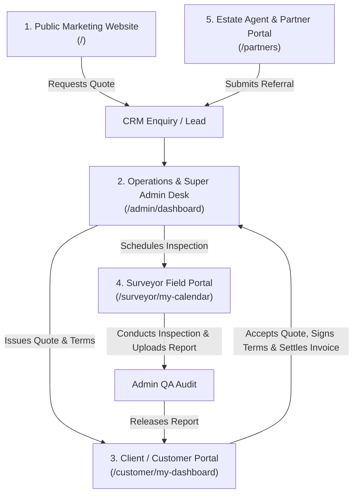
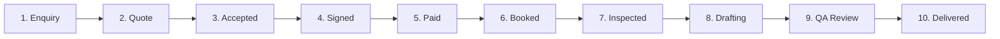

# 📘 NJS Property Group — Complete Client Testing & Walkthrough Guide
### *End-to-End System Journey, Role Portals, Menu Navigation & Step-by-Step Testing Playbook*

---

## 📌 Document Overview & Purpose

Welcome to the **NJS Property Group Digital Surveying & Practice Management Platform**.

This document is your **step-by-step testing manual**. Whether you are evaluating the platform from the perspective of an end **Client (Property Buyer)**, an **Operations Admin**, a **RICS Chartered Surveyor**, an **Office Coordinator**, or a **Partner Estate Agent**, this guide walks you through every button, dashboard, and workflow transition from initial enquiry to final report delivery.

---

## 🗺️ System Architecture & Portals at a Glance

The platform is divided into **5 dedicated portals**:

| Portal Name | Target Audience | Primary Default URL | Key Capabilities |
|---|---|---|---|
| **Public Website** | Homebuyers, Solicitors, Property Investors | `/` | Service browsing, instant fee calculator, public quote request. |
| **Client / Customer Portal** | Homebuyers & Property Owners | `/customer/my-dashboard` | 14 dedicated menus: Quotations, Terms, Invoices, Tracker, Chat, Reports. |
| **Super Admin & Admin** | Practice Directors & Senior Operations | `/admin/dashboard` | 11 modules: CRM, Quotes, Jobs, Calendar, Surveyor dispatch, Finance, QA. |
| **Admin / Staff** | Booking Coordinators & Admin Team | `/staff/dashboard` | Booking calendar, client liaison, lead progression, report dispatch. |
| **Surveyor Field Portal** | RICS Chartered Surveyors | `/surveyor/my-calendar` | Field diary, appointment schedule, key access, report upload. |
| **Partner Portal** | Estate Agents, Mortgage Brokers, Solicitors | `/partners` | Referral submissions, live milestone tracker, commission ledger. |

---

## 🔑 Quick Login Reference for Testing

To test different roles on local development or staging:

| Role | Email | Password | Direct Login Link |
|---|---|---|---|
| **Super Admin** | `admin@njspropertygroup.com` | `admin123` *(or your test pass)* | `/admin/login` |
| **Admin Staff** | `staff@njspropertygroup.com` | `staff123` | `/admin/login` |
| **Surveyor** | `surveyor@njspropertygroup.com` | `surveyor123` | `/surveyor/login` |
| **Customer** | *(Created on quote request or pre-registered)* | Provided in email | `/customer/login` |

> 💡 **Tip:** On the `/login` page, you will find quick-fill role pills to test without typing credentials manually.

---

## 🔄 The Complete 10-Stage RICS Lifecycle Journey

Here is the exact step-by-step workflow of a property survey instruction. Follow these stages in order to test the whole application from scratch:

---

### 🟢 STAGE 1: Public Website & Instant Quote Request
**Who performs this:** The Homebuyer / Client (Public Visitor)  
**Where to go:** Open `/` or `/request-quote`

#### Steps to Execute:
1. Navigate to the top navigation bar and click **"Get a Free Quote"** or navigate to `/request-quote`.
2. Select your required RICS Service:
   - **RICS Level 2 Homebuyer Survey**
   - **RICS Level 3 Building Survey**
   - **Snagging Inspection (New Build)**
   - **Residential Valuation Report**
   - **Specialist Damp & Timber Survey**
3. Enter Property Details:
   - Property Postcode (e.g. `NW1 4NP` or `SW1A 1AA`)
   - Property Address (e.g. `14 Baker Street, London`)
   - Approximate Number of Bedrooms (e.g. `3 Bedrooms`)
   - Estimated Property Value (e.g. `£450,000`)
4. Enter Contact Details:
   - **Full Name** (e.g. `Alexander Wright`)
   - **Email Address** (Use your own email to receive real Resend emails)
   - **Phone Number** (e.g. `07700 900123`)
5. Click **"Submit Quote Request"**.

#### Expected System Result:
- An instant success banner appears with your unique Enquiry Reference (`ENQ-2026-XXXX`).
- An email alert is dispatched to `info@njspropertygroup.com`.
- A customer portal account is automatically provisioned for that email address.
- A live in-app notification is logged for the Admin Team.

---

### 🟢 STAGE 2: Admin Lead Review & Issuing Formal RICS Quote
**Who performs this:** Super Admin / Operations Coordinator  
**Where to go:** Login as Admin -> Navigate to `/admin/crm-and-leads`

#### Steps to Execute:
1. In the sidebar, click **"CRM & Leads"** (`/admin/crm-and-leads`).
2. You will see the new enquiry at the top of the table marked **"NEW"**.
3. Click on the lead or click the **"Actions" -> "Generate Quote"** button.
4. The Quotation Builder modal will appear:
   - The Base Inspection Fee is auto-calculated based on property value and survey type.
   - You can add standard inclusions or extras (e.g. Drone Roof Survey, Thermal Imaging).
   - Notice the automatic **UK 20% VAT** calculation:
     $$\text{Total Amount} = \text{Base Fee} + \text{VAT (20\%)}$$
5. Click **"Issue & Send Formal Proposal"**.

#### Expected System Result:
- The lead status advances to `QUOTE_SENT`.
- A formal HTML Quotation Proposal Email is sent to the customer via Resend with a secure login link.
- In-app notification bell dropdown updates for both customer and admin.

---

### 🟢 STAGE 3: Client Reviews & Accepts the Quotation
**Who performs this:** Client / Customer  
**Where to go:** Login to Customer Portal -> `/customer/my-dashboard` -> `/customer/quotations`

#### Steps to Execute:
1. The customer clicks the link in their email or logs into `/customer/login`.
2. The Customer Dashboard displays:
   - Current Phase: **Stage 2 of 10: Quote Issued**.
   - Quotation Card showing the quoted fee.
3. In the sidebar, click **"My Quotations"** (`/customer/quotations`).
4. Click **"Review Proposal"** to see the fee breakdown:
   - Base Professional Fee
   - Statutory 20% UK VAT
   - Scope of Inspection & Terms summary
5. Click the green button **"Accept Quotation"**.

#### Expected System Result:
- The quotation status changes to `ACCEPTED`.
- The live 10-Stage Progress Tracker on the Dashboard moves to **Stage 3: Accepted**.
- An email confirmation is sent to both client and admin.
- An in-app notification appears in the top-right bell dropdown.

---

### 🟢 STAGE 4 & 5: RICS Terms of Engagement Digital Signature
**Who performs this:** Admin issues terms -> Customer digitally signs  
**Where to go:**
- Admin: `/admin/terms-and-documents`
- Customer: `/customer/terms-to-sign`

#### Steps to Execute:
1. **Admin Action:**
   - In `/admin/terms-and-documents`, click **"Generate Terms of Engagement"** for this job.
   - Select standard RICS Consumer Terms or Commercial Terms.
   - Click **"Send for Electronic Signature"**.
2. **Customer Action:**
   - In the Customer Portal, click **"Terms to Sign"** in the sidebar.
   - Review the complete RICS Letter of Engagement clauses (liability, limitations, complaint handling procedure).
   - Check the declaration box: *"I confirm that I have read and agree to the RICS Terms of Engagement"*.
   - Type your full name into the **Digital Signature Pad**.
   - Click **"Sign & Execute Agreement"**.

#### Expected System Result:
- The system generates an audit record containing:
  - Cryptographic SHA-256 Signature Hash
  - Signer IP Address
  - Exact UTC Timestamp
- The job advances to **Stage 4: Terms Signed**.
- An email with the signed terms audit confirmation is dispatched.
- Top-right notification bell updates.

---

### 🟢 STAGE 6: Invoice Payment (Card or BACS Transfer)
**Who performs this:** Customer settles fee OR Admin reconciles bank transfer  
**Where to go:**
- Customer: `/customer/invoices-and-payments`
- Admin: `/admin/quotations-and-payments`

#### Method A: Online Card Settlement (Stripe Gateway)
1. In Customer Portal, click **"Invoices & Payments"**.
2. Locate the outstanding invoice showing `PENDING`.
3. Click **"Pay Online (Card)"**.
4. In the payment modal, complete the card payment simulation.
5. Click **"Authorise & Pay £XXX.XX"**.

#### Method B: BACS Bank Transfer (Direct Reconcile)
1. The client transfers funds directly via UK Faster Payments / BACS.
2. In Admin Portal (`/admin/quotations-and-payments`), find the invoice.
3. Click **"Record BACS Settlement"**.
4. Enter Bank Reference (e.g. `HSBC-BACS-88421`) and click **"Confirm Reconciliation"**.

#### Expected System Result:
- Invoice status switches to `PAID`.
- An official **HMRC-compliant 20% VAT Receipt** is generated with VAT Registration Number and issued to the customer.
- The 10-Stage Tracker progresses to **Stage 5: Paid**.
- Email and in-app bell notification created.

---

### 🟢 STAGE 7: Surveyor Assignment & Inspection Booking
**Who performs this:** Admin / Booking Coordinator  
**Where to go:** `/admin/booking-calendar` or `/admin/survey-jobs`

#### Steps to Execute:
1. In the sidebar, click **"Booking Calendar"** (`/admin/booking-calendar`) or **"Survey Jobs"** (`/admin/survey-jobs`).
2. Click on the job card or click **"Schedule Inspection"**.
3. Select an accredited surveyor from the dropdown (e.g. `David Miller, MRICS`).
4. Pick an **Inspection Date** and **Time Slot** (e.g. `Tomorrow at 10:00 AM`).
5. Enter Access / Key Collection Instructions:
   - Estate Agent contact details
   - Keybox code / vendor attendance instructions
6. Click **"Confirm & Dispatch Surveyor"**.

#### Expected System Result:
- The appointment appears in the Admin Booking Calendar and syncs with the assigned Surveyor’s diary.
- The customer receives an **"Inspection Appointment Confirmed"** email with surveyor name, date, and access guidelines.
- The customer can view their surveyor's credentials under **"Assigned Surveyor"** (`/customer/assigned-surveyor`).
- Tracker moves to **Stage 6: Booked**.

---

### 🟢 STAGE 8: Surveyor Conducts Inspection & Uploads Report
**Who performs this:** RICS Surveyor  
**Where to go:** Login as Surveyor -> `/surveyor/my-calendar` or `/surveyor/upload-reports`

#### Steps to Execute:
1. Log into the Surveyor Portal.
2. Under **"My Diary / Calendar"**, click on the assigned inspection.
3. View site location, vendor details, and access notes.
4. Click **"Mark Site Inspection Complete"** once on-site inspection is finished.
5. Go to **"Upload Reports"** (`/surveyor/upload-reports`).
6. Select the Job and upload the completed RICS survey document (PDF format).
7. Add internal surveyor notes (e.g. *"Significant damp readings on north wall; remedial damp-proof course recommended"*).
8. Click **"Submit for Quality Assurance (QA)"**.

#### Expected System Result:
- Job status updates to `STAGE 8: Drafting / QA Review`.
- Admin QA team is notified that a report is waiting for technical review.
- Privacy Shield ensures surveyor cannot view customer financial receipts or invoice values.

---

### 🟢 STAGE 9 & 10: QA Sign-off, Report Delivery & Review
**Who performs this:** Super Admin signs off -> Customer downloads report  
**Where to go:**
- Admin: `/admin/reports-and-analytics`
- Customer: `/customer/reports`

#### Steps to Execute:
1. **Admin QA Audit:**
   - In Admin Portal, click **"Reports & Analytics"** (`/admin/reports-and-analytics`).
   - Click on the report pending QA.
   - Review RICS compliance checklist.
   - Click **"Approve QA & Release to Customer Portal"**.
2. **Customer Access:**
   - The customer receives an instant email: **"Your RICS Survey Report is Ready"**.
   - An in-app notification appears in the bell dropdown.
   - In the Customer Portal, click **"My Reports"** (`/customer/reports`).
   - Click **"Download Official PDF Report"**.
   - In the sidebar, click **"Leave a Review"** (`/customer/leave-review`) to submit a 5-star rating and client feedback.

#### Expected System Result:
- The 10-Stage Progress Tracker reaches **100% — Stage 10: Delivered**.
- Customer audit trail is permanently stored.

---

## 💬 Testing Live Direct Messages & Presence (Chat System)

The platform includes an **intercom-style instant communication desk** between Client and Practice Operations.

### How to test:
1. **Open two browser windows side by side:**
   - Window 1: Customer Portal (`/customer/messages`).
   - Window 2: Admin Portal (`/admin/messages`).
2. **Online / Offline Presence Test:**
   - When Customer is logged in and viewing the portal, Admin sees a green dot: **"Online • Active Direct Channel"**.
   - When Customer logs out or closes the tab, Admin sees: **"Offline • Last seen, HH:MM"** with the exact timestamp.
3. **Messaging Test:**
   - Send a message from Customer to Admin:
     - Admin hears an audio chime and sees an unread notification badge on the sidebar.
     - Admin top-right notification dropdown updates instantly.
     - Admin receives an email alert with the message snippet.
   - Reply from Admin to Customer:
     - Customer receives real-time reply bubble in the chat view.
     - Top-right notification bell badge lights up (`+1`).
     - Customer receives an email alert with direct login link.

---

## 📋 Comprehensive Menu-by-Menu Testing Matrix

Use this checklist during your walkthrough to verify every single screen:

### 1. Customer Portal (14 Menus)

| # | Menu Name | Path | What to Check & Click |
|---|---|---|---|
| 1 | **Dashboard** | `/customer/my-dashboard` | 10-Stage RICS Tracker, 4 quick summary cards, quick action shortcuts. |
| 2 | **My Quotations** | `/customer/quotations` | List of quotes, 20% VAT breakdown, "Accept Quotation" button. |
| 3 | **My Bookings** | `/customer/my-bookings` | Scheduled inspection dates, address, property type. |
| 4 | **Track My Survey** | `/customer/track-my-survey` | Milestone visualizer from Enquiry to Report Delivery. |
| 5 | **Appointment Details**| `/customer/appointment-details` | Date, time slot, property access details. |
| 6 | **Assigned Surveyor** | `/customer/assigned-surveyor` | Surveyor profile, RICS registration number, photo, bio. |
| 7 | **Terms to Sign** | `/customer/terms-to-sign` | Legal terms view, declaration checkbox, digital signature pad. |
| 8 | **Invoices & Payments**| `/customer/invoices-and-payments`| Invoice balance, "Pay Online" Stripe button, HMRC VAT receipt download. |
| 9 | **My Reports** | `/customer/reports` | Finalized survey reports, download button, PDF view. |
| 10 | **Messages** | `/customer/messages` | Full direct chat thread with admin, file attachments, online indicator. |
| 11 | **Leave a Review** | `/customer/leave-review` | Star rating (1-5), feedback text area, submit review button. |
| 12 | **Support** | `/customer/support` | Direct phone number, email support form, FAQ accordion. |
| 13 | **My Details** | `/customer/my-details` | Contact information, billing address edit form. |
| 14 | **Previous Surveys** | `/customer/previous-surveys` | Archive of past completed property surveys. |

---

### 2. Super Admin & Admin Portal (11 Modules)

| # | Menu Name | Path | What to Check & Click |
|---|---|---|---|
| 1 | **Dashboard** | `/admin/dashboard` | Key business KPIs, instruction volume, revenue charts, live activity feed. |
| 2 | **Users & Roles** | `/admin/users-and-roles` | User accounts list, role permissions (Admin, Staff, Surveyor, Client). |
| 3 | **Companies** | `/admin/companies` | Corporate clients, panel managers, law firms, estate agency accounts. |
| 4 | **Surveyors** | `/admin/surveyors` | Surveyor directory, professional indemnity insurance dates, coverage postcodes. |
| 5 | **CRM & Leads** | `/admin/crm-and-leads` | Inbound quote requests, lead status pipeline, quotation generator. |
| 6 | **Survey Jobs** | `/admin/survey-jobs` | Active job list, stage filters, surveyor assignment, job detail drawers. |
| 7 | **Messages Inbox** | `/admin/messages` | Multi-contact message threads, client filter, quick reply desk. |
| 8 | **Quotations & Payments**| `/admin/quotations-and-payments`| Quote proposals, invoice ledger, BACS payment reconciliation modal. |
| 9 | **Terms & Documents** | `/admin/terms-and-documents` | Legal templates, executed digital agreements, cryptographic audit logs. |
| 10 | **Reports & Analytics** | `/admin/reports-and-analytics` | QA review queue, PDF approval and publish trigger, turnaround metrics. |
| 11 | **Settings** | `/admin/settings` | Company details, VAT registration, email automation toggles, API keys. |

---

### 3. Surveyor Field Portal (7 Menus)

| # | Menu Name | Path | What to Check & Click |
|---|---|---|---|
| 1 | **My Diary / Calendar** | `/surveyor/my-calendar` | Daily and weekly inspection diary, location pins, schedule overview. |
| 2 | **Field Dashboard** | `/surveyor/dashboard` | Assigned jobs count, pending site visits, quick actions. |
| 3 | **My Jobs** | `/surveyor/my-jobs` | Active field jobs list, instruction scope, property address. |
| 4 | **Site Visits & Key Access**| `/surveyor/site-visits` | Access instructions, estate agent keys, vendor phone numbers. |
| 5 | **Upload Reports** | `/surveyor/upload-reports` | Upload draft PDF, add technical surveyor notes, submit for QA. |
| 6 | **My Availability** | `/surveyor/my-availability` | Working days selector, holiday calendar, blackout dates. |
| 7 | **Messages** | `/surveyor/messages` | Direct communication channel with the operations desk. |

---

### 4. Estate Agent & Referral Partner Portal

| Feature | Path | What to Check & Click |
|---|---|---|
| **Partner Dashboard** | `/partners` | Referral metrics, total introduced clients, earned commission tally. |
| **Submit Referral** | `/partners?action=submit` | Form to introduce a client for Homebuyer or Building Survey. |
| **Referral Ledger** | `/partners` | Live progress of introduced surveys (Enquiry -> Booked -> Paid). |
| **Property Intelligence** | `/partners?tab=intel` | UK Postcode EPC rating lookup and Land Registry data widget. |

---

## 🛠️ Verification & Edge Cases to Test

During your testing, verify that these safety and compliance controls work as intended:

1. **Strict Privacy Shield:**
   - Log in as **Surveyor** and verify that no customer invoice amounts, payment receipts, or BACS settlement data are visible.
2. **Zero 404 Route Protection:**
   - Test alternative URLs such as `/customer/my-quotations`, `/customer/my-reports`, `/customer/dashboard`, `/admin/finance/quotations` — verify that each automatically redirects to the correct page without showing a broken 404 screen.
3. **Resend Email Integration:**
   - Check your inbox for actual dispatched emails during Quote Proposal, Terms Signing, Card Payment VAT Receipt, and Report Ready notifications.
4. **Digital Signature Integrity:**
   - In `/customer/terms-to-sign`, attempt to submit without signing or without checking the declaration to verify validation alerts.
5. **Bell Notification Sync:**
   - Click the top-right bell icon. Verify that clicking **"Mark all read"** marks all items read, and clicking an individual notification navigates directly to that job/invoice/message thread.
