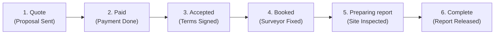

# Project ke Sabse Complex Parts — Easy Explanation Guide

**Project:** UK Property Surveying Practice (NJS Property Group)  
**Document Purpose:** Is software me kaun se modules sabse zyada complex (challenging) hain aur unhe aasan tarike se kaise handle kiya gaya hai.  
**Language:** Simple Hinglish + English (Easy to understand for developers & clients)  

---

## 📌 Quick Summary

Is platform me **4 sabse complex parts** hain:

```
┌────────────────────────────────────────────────────────────────────────┐
│                        TOP 4 COMPLEX PARTS                             │
├─────────────────────┬──────────────────────────┬───────────────────────┤
│ 1. 6-Stage Pipeline │ 2. 30-Page RICS PDF      │ 3. Digital Signature  │
│  State Machine      │  Report with Photos      │  Legal Audit Trail    │
├─────────────────────┴──────────────────────────┴───────────────────────┤
│ 4. Surveyor Postcode Allocation & Key Collection Logistics            │
└────────────────────────────────────────────────────────────────────────┘
```

---

## 🔴 Complex Part 1: 6-Stage Asynchronous State Machine (SurveyBooker Lifecycle)

### Aam Bhasha Me Samjho:
Yeh koi Swiggy ya Amazon ka 2-minute ka order nahi hai. Ek property survey **3 se 10 din** tak chalta hai aur isme **3 alag-alag log (Customer, Admin, Surveyor)** aur bahar ke log (Estate Agent, Seller) shamil hote hain.

### Kyun Complex Hai:
1. **Strict Dependency Rules:**
   - Aap seedhe inspection `Booked` nahi kar sakte jab tak Customer ne **Payment** na ki ho (`Paid`) AUR **Contract** sign na kiya ho (`Accepted`).
   - Job tabhi `Complete` ho sakti hai jab Surveyor ne site visit karke report upload ki ho aur Admin ne QA audit pass kiya ho.
2. **Side-Effects on Every Transition:**
   - Jaise hi status badalta hai:
     - Customer aur Surveyor ko automatically milestone email dispatch honi chahiye.
     - Admin dashboard ke 6 action buckets (`Quotes to submit` ➔ `Jobs to book` ➔ `Reports to upload`) me numbers live update hone chahiye.
3. **Rescheduling & Rollbacks:**
   - Agar vendor ne chabi nahi di ya inspection cancel ki, to poore state ko bina data kharab kiye wapas reschedule karna padta hai.



### Iska Aasan Solution:
* Har Job Record me ek `stage` variable hota hai (`quote`, `paid`, `accepted`, `booked`, `preparing_report`, `complete`).
* Ek central event handler har transition par automated email trigger karta hai aur dashboard buckets update karta hai.

---

## 🔴 Complex Part 2: 30-Page Dynamic RICS PDF Report Generation

### Aam Bhasha Me Samjho:
Customer ko aam invoice nahi, balki UK standard (RICS) ki official **25 se 50 pages lambi survey report** milti hai jisme ghar ki har ek kamzori aur photo hoti hai.

### Kyun Complex Hai:
1. **Dozens of Heavy Photos:**
   - Surveyor apne phone se 40 se 80 high-resolution photos leta hai (Damp moisture reading, roof chimney, guttering, brick cracks).
   - In sabhi photos ko PDF me dynamic page layouts ke sath fit karna server memory par heavy hota hai.
2. **RICS Traffic-Light Condition Ratings:**
   - Report me official color-coded tables banti hain:
     - 🟢 **Condition 1 (Green):** No repair needed.
     - 🟡 **Condition 2 (Amber):** Defects needing repair, not urgent.
     - 🔴 **Condition 3 (Red):** Urgent structural defects requiring immediate specialist attention.
3. **Surveyor Signature & Valuation Numbers:**
   - Surveyor ka digital stamp, MRICS credential number, aur market valuation figure legally correct jagah print hona chahiye.

### Iska Aasan Solution:
* Node.js me **`@react-pdf/renderer`** ya **`pdfmake`** use hota hai.
* Photos ko pehle cloud storage (AWS S3) par compress (800px) karke rakha jata hai taaki PDF size 5 MB se chhota rahe aur 2 second me download ho jaye.

---

## 🔴 Complex Part 3: Digital Signature & Legal Audit Trail (RICS Terms)

### Aam Bhasha Me Samjho:
UK ke kanoon ke mutabiq jab tak client terms sign nahi karta, surveyor ghar ke andar nahi ja sakta. Yeh sign legal court proof hota hai.

### Kyun Complex Hai:
1. **High Liability (£1,000,000 PI Insurance):**
   - Agar baad me client court me bol de ki *"Maine ye condition accept nahi ki thi"*, to firm fas sakti hai.
2. **Tamper-Evident Evidence Required:**
   - Sirf checkbox dabana kafi nahi hota. System ko ye capture karna padta hai:
     - Customer ka Sign (Drawn on screen ya typed)
     - IP Address (e.g. `82.165.197.1`)
     - Exact Date & Time (UTC Timestamp)
     - Browser User-Agent details
   - Ek locked PDF agreement generate hoti hai jo badal nahi sakti.

### Iska Aasan Solution:
* Frontend par HTML5 Canvas signature pad (`CustomerTermsPage.jsx`) banaya gaya hai.
* Sign submit hote hi signature image aur timestamp client record me permanently attach ho jate hain.

---

## 🔴 Complex Part 4: Surveyor Postcode Routing & Key Access Logistics

### Aam Bhasha Me Samjho:
Surveyor desk job nahi karta, wo car se London aur Home Counties me travel karta hai. Har din alag jagah jana hota hai aur chabi collect karni hoti hai.

### Kyun Complex Hai:
1. **Daylight Hours Restriction:**
   - UK me surveys sirf suraj ki roshni me (subah 10:00 se dopahar 16:00 ke beech) hi ho sakte hain. Raat ko inspection allowed nahi hai.
2. **Key Collection Logistics (Double Travel):**
   - Surveyor seedhe ghar nahi jata. Pehle usko **Estate Agent branch** (jaise Savills Mayfair) jakar physical keys pick karni hoti hain, fir ghar inspect karna hota hai, fir key wapas agent ko deni hoti hai.
3. **Postcode Territory Mapping:**
   - Har surveyor ka specific postcode zone hota hai (jaise David Thorne = SW & Central London, Oliver Hughes = W & Surrey). System ko sahi surveyor ko job deni hoti hai taaki travel time waste na ho.

### Iska Aasan Solution:
* Surveyor Portal me har appointment ke sath **"Key Collection & Access Logistics"** card clear highlight hota hai jisme agent name, branch address, phone number aur lockbox code likha hota hai.

---

## 💡 Developer & Architecture Summary

| Complex Module | Main Risk / Challenge | Easy Solution Approach |
| :--- | :--- | :--- |
| **1. 6-Stage Pipeline** | State skip hona ya galat stage trigger hona | Centralized state engine + contextual "What's Next?" buttons |
| **2. Heavy RICS PDF** | 80 photos se server slow hona | Cloudinary/S3 compressed image pipeline + `@react-pdf` |
| **3. Digital E-Sign** | Legal disputes in UK courts | Signature canvas + IP address & timestamp metadata snapshot |
| **4. Surveyor Travel** | Missed appointments & daylight loss | Postcode zone filters + Key collection details on mobile cards |
