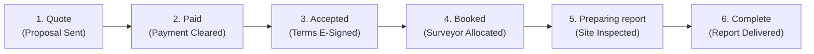
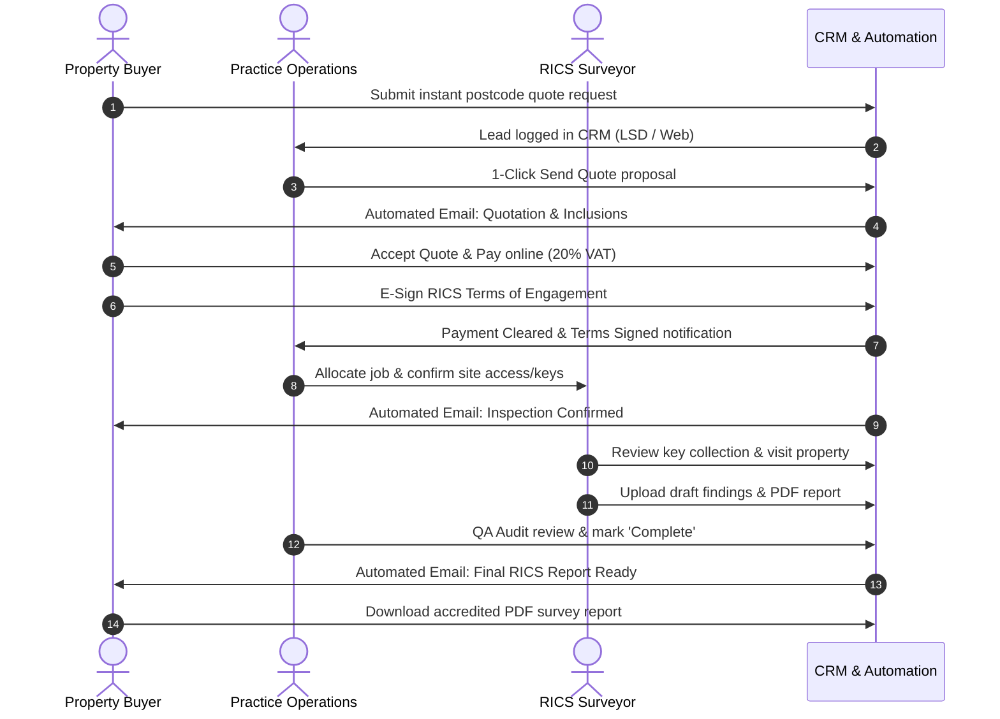

# UK Property Surveying Practice — Complete Workflow & System Guide

**Project:** UK Property Surveying Practice (NJS Property Group)  
**Industry Benchmark:** [e.surv Chartered Surveyors](https://www.esurv.co.uk/) & [SurveyBooker CRM](https://www.surveybooker.com/)  
**Governing Standard:** Royal Institution of Chartered Surveyors (RICS Home Survey Standard)  
**Last Updated:** October 2026  

---

## 1. Executive Summary

This application is an end-to-end enterprise CRM and business operations platform for an independent UK property surveying practice. It automates the entire lifecycle of RICS residential and commercial property surveys:

1. **Lead capture & instant quote calculation** from public website and external aggregators (Local Surveyors Direct - LSD).
2. **Quote proposal generation & fee structuring** with UK 20% VAT calculations.
3. **Client payment processing & digital execution of RICS Terms of Engagement**.
4. **Surveyor allocation & site access logistics** (estate agent key collection, lockbox codes).
5. **On-site field inspections, photo defect logging & report drafting**.
6. **Mandatory QA audit & final RICS PDF delivery** with automated client email milestones.

---

## 2. User Roles & Dedicated Portals

Per client explicit instruction, all legacy "Agent" logins have been permanently removed. The system operates on **3 strictly separated, secure user roles**:

```
┌────────────────────────────────────────────────────────────────────────┐
│                        3 PRIMARY USER ROLES                            │
├─────────────────────┬──────────────────────────┬───────────────────────┤
│ 1. CUSTOMER (Client)│ 2. SURVEYOR (Field RICS) │ 3. ADMIN (Management) │
│  Property Buyer     │  Chartered Inspector     │  HQ Operations Head   │
└─────────────────────┴──────────────────────────┴───────────────────────┘
```

| User Role | Dedicated Login URL | Default Demo Credentials | Post-Login Landing Page | Primary Responsibilities |
| :--- | :--- | :--- | :--- | :--- |
| **Customer (Client)** | [`/login`](http://localhost:5175/login)<br/>*(also `/login/customer`)* | `customer@demo.com`<br/>`password123` | [`/customer/my-dashboard`](http://localhost:5175/customer/my-dashboard) | • Calculate instant postcode quotes<br/>• Accept fee proposals<br/>• Pay survey invoices online<br/>• E-sign RICS terms of engagement<br/>• Track live survey progress<br/>• Download final accredited RICS PDF report |
| **Surveyor (Field)** | [`/login/surveyor`](http://localhost:5175/login/surveyor)<br/>*(also `/surveyor/login`)* | `surveyor@demo.com`<br/>`password123` | [`/surveyor/dashboard`](http://localhost:5175/surveyor/dashboard) | • View daily on-site field appointments<br/>• Inspect site access & key collection details<br/>• Capture defect photos & notes on-site<br/>• Upload draft/final survey reports<br/>• Manage calendar working availability |
| **Admin (HQ Operations)** | [`/login/admin`](http://localhost:5175/login/admin)<br/>*(also `/admin/login`)* | `admin@demo.com`<br/>`password123` | [`/admin/dashboard`](http://localhost:5175/admin/dashboard) | • Manage SurveyBooker live action buckets<br/>• Process LSD & website CRM leads<br/>• Dispatch fee quotes & manage UK VAT payments<br/>• Allocate surveyors to inspection instructions<br/>• Maintain call logs & dedicated complaints<br/>• Monitor 48h turnaround SLAs & settings |

> **Security Note:** The public header shows only the **"Customer Login"** button (`/login`). Surveyor and Admin entrances are isolated to dedicated route endpoints (`/login/surveyor` and `/login/admin`) to protect administrative infrastructure from public exposure.

---

## 3. End-to-End Survey Lifecycle (The 6-Stage Pipeline)

Every instructed survey follows the canonical **6-Stage SurveyBooker Progression Pipeline**:



### Stage 1: Quote (Quotation Proposal Issued)
* **Trigger:** Customer fills instant quote calculator on website OR inbound lead arrives from *Local Surveyors Direct (LSD)*.
* **Actions:**
  * Admin generates quotation in CRM with dual pricing (Survey alone vs Survey + Valuation) and 8-point inspection inclusions scope.
  * Lead status changes to `Quoted`.
  * **Automated Email 1:** Quotation Proposal, pricing scope, and booking link sent to customer.

### Stage 2: Paid (Payment Cleared)
* **Trigger:** Customer accepts quote and settles invoice via online card payment (Stripe) or BACS bank transfer.
* **Actions:**
  * System calculates official UK 20% VAT and generates invoice receipt.
  * Settled funds appear in Admin financial registers.
  * **Automated Email 2:** Payment Receipt & Client Onboarding Welcome Pack dispatched.

### Stage 3: Accepted (Terms of Engagement Signed)
* **Trigger:** Customer accesses "Terms to Sign" in Client Portal.
* **Actions:**
  * Customer digitally executes legally binding RICS contractual agreement (covering liability limit, visual fabric protocol, and moisture meter checks).
  * Contract is archived in digital audit register.
  * **Automated Email 3:** Terms of Engagement Signed Confirmation dispatched to customer.

### Stage 4: Booked (Site Inspection Confirmed & Allocated)
* **Trigger:** Admin verifies cleared payment + signed terms, then allocates a chartered surveyor based on postcode coverage and calendar availability.
* **Actions:**
  * Admin confirms access logistics (e.g. Savills branch key collection ref #SG-491 or vendor lockbox code).
  * Inspection date and daylight time-slot (e.g. 10:00 - 13:00) locked in calendar.
  * Surveyor's mobile portal updates with job details.
  * **Automated Email 4:** Site Inspection Confirmed & Access Logistics sent to client and estate agent.

### Stage 5: Preparing Report (Site Visited & Report Drafting)
* **Trigger:** Surveyor attends property on scheduled date.
* **Actions:**
  * Surveyor inspects structural fabric, takes damp readings, inspects loft/roof voids, and logs defect photos (Traffic-Light Condition Ratings 1, 2, 3).
  * Surveyor uploads draft findings or compiled report.
  * **Automated Email 5:** Site Inspection Completed & Report Drafting notice sent to customer.

### Stage 6: Complete (QA Audit Passed & Final PDF Delivered)
* **Trigger:** Admin conducts mandatory QA peer audit and marks job status as `Complete`.
* **Actions:**
  * Official signed RICS PDF Survey Report is released.
  * Customer downloads report directly from Client Portal (`/customer/reports`).
  * Direct telephone debrief is offered.
  * **Automated Email 6:** Final RICS Survey Report Ready for Download notification dispatched.

---

## 4. Admin SurveyBooker Action Buckets (Live Queue)

The Admin Dashboard provides real-time operational buckets inspired by SurveyBooker:

```
┌────────────────────────────────────────────────────────────────────────┐
│               SURVEYBOOKER WORKFLOW • PRIORITY ACTION BUCKETS          │
├────────────────────┬────────────────────┬──────────────────────────────┤
│ 📥 Quotes to submit│ ✍️ Terms to send   │ 📅 Jobs to book              │
│    LSD & Inbound   │    Awaiting contract│   Paid, awaiting surveyor   │
├────────────────────┼────────────────────┼──────────────────────────────┤
│ 📍 Appointments    │ 📤 Reports to upload│ 🗓️ Calendar & Tasks         │
│    Confirmed visits│    Inspected, QA due│    Daily inspection schedule │
└────────────────────┴────────────────────┴──────────────────────────────┘
```

1. **Quotes to submit:** Inbound leads from LSD and website requiring quotation proposal dispatch within 2 business hours.
2. **Terms to send:** Accepted proposals awaiting RICS legal contract issuance.
3. **Jobs to book:** Cleared funds where surveyor allocation and estate agent access confirmation are required.
4. **Appointments:** Confirmed on-site inspections scheduled across London and the Home Counties.
5. **Reports to upload:** Surveys completed on-site awaiting PDF document compile and QA audit release.
6. **Calendar & Tasks:** Interactive monthly and daily calendar showing inspection dots and time-blocked task cards.

---

## 5. Detailed Module Architecture

### 5.1 CRM & Leads Register (`/admin/leads`)
* **Sources:** Local Surveyors Direct (LSD), Website Instant Quote, Phone Inquiry, Estate Agent Referral.
* **Actions:** 1-Click "Send Quote" modal with instant email dispatch and deal pipeline calculation.
* **Filters:** Filter by lead status (`New`, `Quoted`, `Follow-up`, `Won`, `Lost`).

### 5.2 Client Profile & Dedicated Complaints Log
Accessible across CRM, Users, and Survey Jobs:
* **Call Communication Log:** Split actions:
  * `Save as note`: Internal staff operational memo.
  * `Save as call`: Timestamped call history record (Inbound/Outbound, caller identity, discussion points).
* **Dedicated Complaints Register:** Separate formal register with Complaint ID, Status (`Open`, `Under Investigation`, `Resolved`), Severity, Category, and formal Resolution Audit notes.

### 5.3 Survey Jobs Master Register (`/admin/jobs`)
* Complete register of all active, scheduled, completed, and on-hold instructions.
* Dynamic filter tabs (`All Jobs`, `Scheduled`, `In Progress`, `Completed`, `On Hold`, `Waiting Terms & Payment`).
* Contextual "What's Next?" guidance box on every Job Record page.

### 5.4 Quotations & Payments Gateway (`/admin/quotes`)
* HMRC-compliant UK 20% VAT calculations on all survey disciplines.
* Real-time metrics: Settled Revenue (Paid), Outstanding Invoices, Standard VAT Rate (20.0%).
* Official downloadable VAT receipts and Stripe payment settlement audit trail.

### 5.5 Terms of Engagement Register (`/admin/terms`)
* Pre-configured templates across **6 Core Disciplines**:
  1. *Homebuyer L2:* RICS Home Survey Standard (Level 2).
  2. *Building L3:* Comprehensive Building Survey (Level 3) Structural Terms.
  3. *Snagging:* New Build Snagging & Quality Defect Inspection Mandate.
  4. *Valuation:* RICS Red Book Global Residential & Commercial Valuation Terms.
  5. *Damp:* Specialist Moisture, Timber & Structural Dampness Terms.
  6. *Expert Witness:* Civil Procedure Rules (CPR Part 35) Mandate.
* Digital signature status tracking (`Signed`, `Sent`, `Pending`).

### 5.6 Surveyor Field Portal (`/surveyor/*`)
* **My Calendar (`/surveyor/calendar`):** Site inspection schedule with exact arrival windows.
* **My Jobs (`/surveyor/jobs`):** Property inspection details, client contact numbers, and lockbox access codes.
* **Upload Reports (`/surveyor/reports`):** Upload completed PDF survey deliverables directly into the job record.
* **My Availability (`/surveyor/availability`):** Manage inspection capacity and holiday block-outs.

### 5.7 Reports & Financial Analytics (`/admin/reports`)
* Executive KPI cards: Gross Invoiced Revenue, Total Survey Inspections, Inquiry Conversion Rate, and Average SLA Turnaround.
* Revenue breakdown by Survey Standard (L2, L3, Valuation, Defect).
* Surveyor Productivity & RICS Audit Quality compliance table.

### 5.8 System Governance & Settings (`/admin/settings`)
* **SMTP Mail Server Configuration:** Host, Port (587 / 465), Encryption (TLS / SSL), Sender Identity, and Test Email modal.
* **Survey Types & Rate Cards:** Pricing rules and baseline fees per discipline.

---

## 6. Interaction Sequence Diagram



---

## 7. Developer Quick Reference

### Running the Application Locally
```bash
# Start development server (runs on port 5175)
npm run dev

# Run Oxlint linter
npm run lint

# Production build
npm run build
```

### Direct Navigation Links for Testing
* **Public Homepage:** `http://localhost:5175/`
* **Customer Sign In:** `http://localhost:5175/login`
* **Customer Dashboard:** `http://localhost:5175/customer/my-dashboard`
* **Surveyor Sign In:** `http://localhost:5175/login/surveyor`
* **Surveyor Dashboard:** `http://localhost:5175/surveyor/dashboard`
* **Admin Sign In:** `http://localhost:5175/login/admin`
* **Admin Dashboard:** `http://localhost:5175/admin/dashboard`
* **CRM & Leads:** `http://localhost:5175/admin/leads`
* **Survey Jobs:** `http://localhost:5175/admin/jobs`
* **Quotations & Payments:** `http://localhost:5175/admin/quotes`
* **Terms & Documents:** `http://localhost:5175/admin/terms`
* **Reports & Analytics:** `http://localhost:5175/admin/reports`
* **Settings & SMTP:** `http://localhost:5175/admin/settings`
